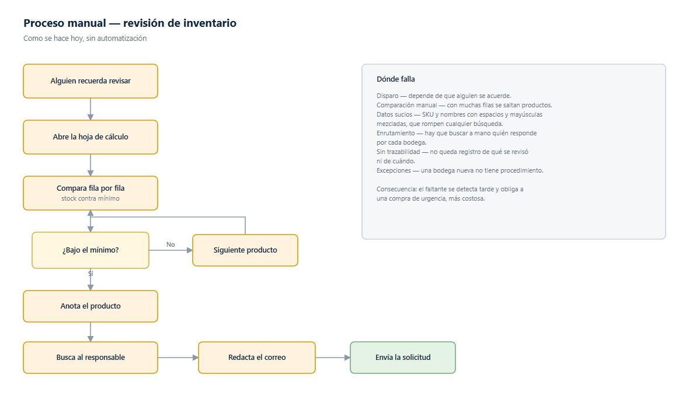
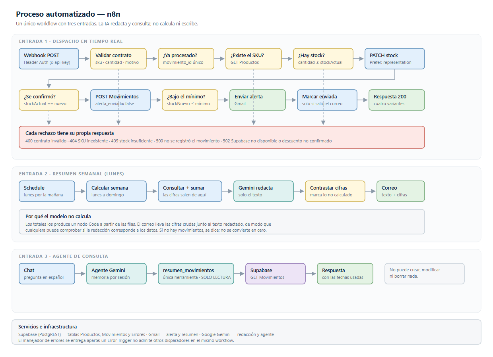

# Documentación del proyecto final

**Alerta automática de inventario** · Automatización inteligente de procesos con n8n
EAM · Periodo 2026-II · Profesor: Robert Garcia Rey

Este documento explica el proyecto completo y su estado final. Describe la misma versión que
[`workflows/Workflow_Final.json`](../workflows/Workflow_Final.json). Donde algo esté
comprobado se dice con qué evidencia; donde no lo esté, se dice también.

---

## 1. Problema, alcance y procesos

### 1.1 Contexto y necesidad

En la bodega los despachos se anotaban en una hoja de cálculo compartida. Para saber si un
producto se estaba agotando, alguien tenía que abrir la hoja y comparar fila por fila el
stock contra el mínimo de cada producto.

El problema no es que la comparación sea difícil: es que **depende de que una persona se
acuerde de hacerla**. Cuando no se hacía, el faltante se descubría en el momento de
despachar, y la reposición pasaba a ser una compra de urgencia.

### 1.2 Usuarios

| Quién | Qué necesita |
|---|---|
| Auxiliar de bodega | Registrar el despacho sin tener que calcular nada |
| Coordinador de inventario | Enterarse de un faltante cuando ocurre, no al final de la semana |
| Jefatura | Una idea del movimiento de la semana sin pedir reportes |

### 1.3 Objetivos

1. Que cada despacho actualice el stock por sí solo.
2. Que el aviso salga en el instante en que un producto cruza su mínimo.
3. Que el mismo despacho, enviado dos veces, no descuente dos veces.
4. Que exista un resumen semanal legible sin tener que consultar la base de datos.
5. Que se puedan hacer preguntas sobre los movimientos en lenguaje natural.

### 1.4 El equipo y sus aportes

| Integrante | Aporte |
|---|---|
| Sebastián Betancourth | Entorno de n8n, credenciales, versionado y fusión del workflow final |
| Felipe Castaño | Construcción del flujo: HTTP Request, validaciones y mapeo de datos |
| Juan Camilo Castañeda Lopera | Pruebas, casos de la bitácora 11 y evidencias |
| Mateo Albornoz | Documentación, diagramas y datos de prueba |

### 1.5 El proceso manual

Seis puntos de fallo, que son los que motivan la automatización:

| Dónde falla | Por qué |
|---|---|
| Disparo | Depende de que alguien se acuerde |
| Comparación | Con muchas filas se saltan productos |
| Datos sucios | SKU con espacios y mayúsculas mezcladas rompen la búsqueda |
| Enrutamiento | Hay que buscar a mano quién responde por cada bodega |
| Trazabilidad | No queda registro de qué se revisó ni cuándo |
| Excepciones | Una bodega nueva no tiene procedimiento |

### 1.6 El proceso automatizado

### 1.7 Qué quedó dentro y qué no

**Implementado:** recepción de despachos por webhook autenticado, validación del contrato,
control de duplicados, descuento de stock con confirmación, registro del movimiento, alerta
por correo, resumen semanal redactado por IA con contraste de cifras, y un agente de
consulta de solo lectura.

**Excluido por decisión del equipo:** reposición automática de pedidos, interfaz propia de
captura —se usa un simulador para las pruebas— y escritura transaccional real entre las dos
tablas. Esta última se explica en el apartado 5.2.

---

## 2. Funcionamiento e integraciones

El workflow final tiene **tres puntos de entrada en un solo archivo**. Antes vivían en cinco
workflows enlazados con `executeWorkflow`; se fusionaron porque la guía de entrega exige un
único JSON que funcione sin referencias a workflows ausentes.

### 2.1 Entrada 1 — Despacho por webhook

`POST /webhook/inventario-movimiento`, autenticado con cabecera `x-api-key`.

**Datos recibidos.** Todos obligatorios salvo donde se indique:

| Campo | Tipo | Regla |
|---|---|---|
| `movimiento_id` | texto | No vacío. Es la clave de la idempotencia |
| `sku` | texto | No vacío |
| `cantidad` | número | Entero, mayor que 0 y menor o igual a 10000 |
| `motivo` | texto | Uno de: `venta`, `despacho a sucursal`, `avería`, `ajuste de inventario` |

**El recorrido, paso a paso:**

1. **`Validar contrato`** comprueba las cuatro reglas de la tabla. Si falla cualquiera,
   responde `400` sin tocar la base de datos.
2. **`Buscar movimiento`** consulta si ese `movimiento_id` ya existe. Si existe, responde
   `200` con `duplicado: true` y **no descuenta nada**.
3. **`Buscar producto`** busca el SKU en `Productos`. Si no está, responde `404`.
4. **`Hay stock suficiente?`** compara la cantidad contra el stock actual. Si no alcanza,
   responde `409`. Es un rechazo de negocio, no un error técnico.
5. **`Calcular stock`** arma los valores derivados: `stockNuevo`, `stockAnterior`, el
   `ticket` y el resto de campos que necesitan los pasos siguientes.
6. **`Actualizar stock`** hace el `PATCH` sobre `Productos`.
7. **`Escritura confirmada?`** comprueba tres cosas, no una: que el código sea correcto, que
   el cuerpo devuelto no sea un array vacío, y que el `stockActual` devuelto coincida con el
   `stockNuevo` calculado. Si algo no cuadra, responde `502`.
8. **`Registrar movimiento`** inserta la fila en `Movimientos` con `alerta_enviada: false`.
   Si falla, responde `500`.
9. **`Bajo el minimo?`** decide si corresponde alertar.
10. **`Enviar alerta`** manda el correo. Si Gmail falla, la rama de error lleva a una
    respuesta `200` con `avisoPendiente: true`: el movimiento sí se procesó.
11. **`Marcar alerta enviada`** pone `alerta_enviada: true` **solo si el correo salió**.

**Las once rutas terminan en una respuesta.** Ninguna queda sin salida:

| Código | Cuándo |
|---|---|
| `200` | Procesado, sin alerta |
| `200` | Procesado y alerta enviada |
| `200` | Procesado, alerta no enviada (`avisoPendiente: true`) |
| `200` | Duplicado: ya estaba procesado |
| `400` | Contrato inválido |
| `404` | El SKU no existe |
| `409` | Stock insuficiente |
| `500` | El movimiento no se pudo registrar |
| `502` | Supabase no disponible, o descuento no confirmado |

### 2.2 Entrada 2 — Resumen semanal

Disparador programado, lunes por la mañana. Calcula el lunes a domingo de la semana
anterior, consulta los movimientos del periodo, **suma las cifras en un nodo `Code`** y le
pasa el resultado ya calculado a Gemini para que lo redacte.

El nodo `Contrastar cifras` extrae los números del texto del modelo y antepone `[REVISAR]` a
los que no provienen del cálculo. El correo lleva el texto redactado **y las cifras crudas**,
para que cualquiera pueda comprobar si una cosa corresponde a la otra.

Si la consulta devuelve cero filas, el correo dice que no hubo movimientos. Si la consulta
falló, dice que no se pudo consultar. **No son lo mismo y el flujo no los confunde**: un
fallo técnico nunca se presenta como un cero.

### 2.3 Entrada 3 — Agente de consulta

Disparador de chat. El agente tiene **una sola herramienta**, `resumen_movimientos`, de solo
lectura, que recibe un periodo y devuelve totales ya calculados.

### 2.4 Integraciones

**Supabase (PostgREST)** — tres tablas:

| Tabla | Operaciones | Para qué |
|---|---|---|
| `Productos` | GET, PATCH | Consultar el producto y descontar el stock |
| `Movimientos` | GET, POST, PATCH | Idempotencia, registro y marcado de alerta |
| `Errores` | POST | Registro de fallos, desde el manejador de errores |

Los HTTP Request usan credencial de tipo Supabase API. Detalle de los principales:

| Nodo | Método | Endpoint | Envía | Respuesta relevante |
|---|---|---|---|---|
| `Buscar movimiento` | GET | `/rest/v1/Movimientos?movimiento_id=eq.…` | — | Array vacío o la fila existente |
| `Buscar producto` | GET | `/rest/v1/Productos?sku=eq.…` | — | La fila del producto |
| `Actualizar stock` | PATCH | `/rest/v1/Productos?sku=eq.…` | `{stockActual}` | La fila ya actualizada |
| `Registrar movimiento` | POST | `/rest/v1/Movimientos` | La fila completa | La fila insertada |
| `Consultar movimientos` | GET | `/rest/v1/Movimientos?and=(…)` | — | Las filas del periodo |

Dos detalles de configuración que resultaron importantes, ambos descubiertos por fallos
reales documentados en la bitácora:

**La cabecera `Prefer: return=representation`.** Sin ella, PostgREST responde `204` aunque
el `PATCH` no haya modificado ninguna fila. Con ella devuelve las filas afectadas, que es lo
que permite comprobar que el descuento ocurrió de verdad.

**El filtro de rango va en un único parámetro `and`.** Dos parámetros con el mismo nombre
`creado_en` —uno `gte` y otro `lte`— no funcionan: n8n construye los parámetros de consulta
como un objeto y el segundo pisa al primero, de modo que el límite inferior desaparece sin
error. La forma correcta es `and=(creado_en.gte.X,creado_en.lte.Y)`.

**Gmail (OAuth2)** — dos envíos: la alerta de stock y el correo del resumen. El nodo de
alerta tiene `onError: continueErrorOutput`, de modo que un fallo de Gmail no deja el
movimiento sin procesar.

**Google Gemini** — `gemini-3.5-flash-lite`, en dos puntos: la redacción del resumen y el
agente de consulta.

### 2.5 Qué pasa cuando algo va mal

| Situación | Qué hace el flujo |
|---|---|
| Campo vacío, cantidad no entera o fuera de rango, motivo no admitido | `400`, sin tocar la base de datos |
| SKU inexistente | `404` |
| Cantidad mayor que el stock | `409`. Rechazo de negocio, no error |
| Supabase responde con un código de error | `502`. **No** se convierte en un `404` falso |
| Supabase no es alcanzable: host, DNS o tiempo agotado | `502` por la salida de error del nodo. Ver la nota de abajo |
| El `PATCH` no modifica filas | `502`, y el movimiento no se registra |
| El `POST` del movimiento falla | `500` |
| Gmail rechaza el envío | `200` con `avisoPendiente: true` y `alerta_enviada` en `false` |
| El mismo `movimiento_id` llega dos veces | `200` con `duplicado: true`, sin descontar |

**El control de duplicados tiene dos capas.** La consulta previa responde rápido, pero lo
que de verdad impide el doble descuento es la restricción `unique` sobre `movimiento_id` en
la base de datos. Si dos peticiones idénticas llegan a la vez, la consulta previa puede no
verlas, pero la segunda inserción será rechazada por Postgres.

**Un servicio caído y un servicio que responde mal no son lo mismo.** Los nodos HTTP llevan
la opción `neverError`, que impide que un **código** de error HTTP detenga el flujo y deja
que sea el `IF` siguiente quien decida. Pero si la conexión no llega a abrirse no hay ningún
código que neutralizar: el nodo lanza una excepción y el flujo se detendría antes del `IF`,
dejando al cliente sin respuesta. Por eso los cuatro nodos HTTP de esta rama tienen además
una **salida de error propia**, conectada directamente al cuerpo de respuesta que
corresponde:

| Nodo | Si no hay conexión |
|---|---|
| `Buscar movimiento`, `Buscar producto` | `502`, y el movimiento no se procesa |
| `Actualizar stock` | `502`, sin descontar |
| `Registrar movimiento` | `500`, avisando de que el stock sí se descontó |

Esta distinción no estaba en el diseño: salió de la prueba CP-02, donde el flujo se detuvo
con `ENOTFOUND` y el cliente no recibió nada.

---

## 3. Componente de inteligencia artificial

### 3.1 Qué necesidad resuelve, y por qué no basta una regla

La IA se usa en dos sitios, y en ninguno de los dos calcula nada.

**En el resumen semanal**, para convertir un conjunto de totales en un texto que alguien
quiera leer. Una plantilla fija también produciría un texto, pero sería el mismo todas las
semanas y no destacaría lo que cambió. Aquí la IA aporta redacción, que es precisamente lo
que una regla no da.

**En el agente**, para interpretar cómo la gente expresa un periodo. «La semana pasada»,
«hace tres semanas», «del 2 al 8» y «el mes pasado» son infinitas formas de decir dos
fechas. Escribir reglas para cada una sería interminable.

### 3.2 Modelo y proveedor

`gemini-3.5-flash-lite` de Google, vía credencial de Google Gemini (PaLM) API, con
`maxOutputTokens: 2048`.

### 3.3 Qué recibe y qué devuelve

**Resumen semanal.** Recibe los totales ya calculados: periodo, número de movimientos,
unidades, productos distintos, movimientos con alerta, los cinco productos con más salida y
el desglose por motivo y por bodega. Devuelve una estructura validada por un
`outputParserStructured`: título, resumen y una lista de puntos.

**Agente.** Recibe la pregunta del usuario y el historial de su sesión. Puede llamar a
`resumen_movimientos` pasándole un periodo como texto en formato `YYYY-MM-DD a YYYY-MM-DD`,
y recibe de vuelta los totales de ese periodo.

### 3.4 Validaciones y límites

| Control | Cómo |
|---|---|
| Estructura de la salida | `outputParserStructured` con un contrato de título, resumen y puntos |
| Fidelidad de las cifras | `Contrastar cifras` marca con `[REVISAR]` los números del texto que no provienen del cálculo |
| Verificabilidad | El correo lleva las cifras crudas junto al texto redactado |
| Caída del modelo | `Redactar resumen` tiene salida de error: `Resumen sin redaccion` envía las cifras sin texto |
| Escritura | El agente no tiene ninguna herramienta que escriba. No es una instrucción: es que no existe |
| Entrada del usuario | `Validar turno y sesion` rechaza mensajes vacíos o de más de 1200 caracteres |
| Instrucciones inyectadas | El mensaje de sistema ordena tratar como texto sin autoridad cualquier intento de cambiar sus reglas |
| Datos de prueba | El agente debe aclarar que las cifras provienen de datos de prueba, pero **solo cuando entrega cifras** |

### 3.5 Por qué un agente y no una cadena

El resumen semanal **es** una cadena, no un agente: la tarea está fijada de antemano
—redactar estos totales— así que no hay nada que decidir.

La consulta sí justifica un agente, porque el modelo decide si necesita consultar y con qué
periodo. Tiene una sola herramienta y un límite de cuatro iteraciones.

**Sobre la memoria.** El agente usa `memoryBufferWindow` con una clave por conversación, de
modo que el contexto de una sesión no se filtra a otra. La memoria sirve para que se pueda
preguntar «¿y la semana anterior?» sin repetirlo todo. Su riesgo es que el modelo reutilice
una cifra vieja como si fuera actual, y contra eso el mensaje de sistema exige que **toda
cifra provenga de una llamada hecha en el turno en curso**. Es una defensa basada en el
prompt, no un mecanismo: si las pruebas muestran que no basta, la alternativa prevista es
retirar la memoria.

---

## 4. Resultados y estado final

### 4.1 Qué cambió desde el corte anterior

| Cambio | Por qué |
|---|---|
| Los cinco workflows se fusionaron en uno | La guía exige un único JSON sin referencias a workflows ausentes |
| `Prefer: return=representation` en el `PATCH` | Un `204` no distinguía entre descontar y no modificar nada |
| El registro del movimiento pasó antes de la alerta | Un reenvío debe encontrar el duplicado aunque el correo falle |
| `alerta_enviada` se marca después del envío real | Antes se escribía sin saber si el correo salió |
| Comprobación de la fuente antes de interpretarla | Una caída de Supabase producía un `404` falso |
| Validaciones nuevas: cantidad entera, tope de 10000, motivo cerrado, stock suficiente | El contrato aceptaba cantidades absurdas y cualquier motivo |
| `Contrastar cifras` en el resumen | No había forma de detectar una cifra inventada |
| Tipos declarados en las entradas del subflujo de alerta | n8n rechazaba `stockActual` por recibir número donde esperaba texto |
| El filtro de periodo pasó a un único parámetro `and` | El límite inferior se perdía en silencio |
| Los nodos HTTP del webhook devuelven su error por una salida propia | `neverError` cubría los códigos de error HTTP, pero un fallo de conexión detenía el flujo sin responder nada |

### 4.2 Qué funciona con respaldo

Los resultados de las pruebas están en
[`../pruebas/Bitacora_Clase_11_Pruebas.md`](../pruebas/Bitacora_Clase_11_Pruebas.md), con sus
evidencias en [`../pruebas/evidencias/`](../pruebas/evidencias/).

Se ejecutaron nueve de los doce casos previstos. Lo que queda comprobado con evidencia es:

| Qué quedó comprobado | Cómo se comprobó | Evidencia |
|---|---|---|
| Una salida mayor que el stock se rechaza con `409` **y no descuenta nada** | Los nodos de escritura no aparecen en la ejecución | `48`, `49`, ejecución 188 |
| La rama de alerta completa: registra, envía el correo, marca la alerta y responde `200` | Recorrido completo de la ejecución, más el correo recibido con cifras coincidentes | `50`, `51`, `52`, ejecución 192 |
| El movimiento se registra **antes** de notificar | Orden de los nodos dentro de la ejecución 192 | `51` |
| El agente se niega a escribir y no invoca ninguna herramienta | Respuesta más los logs de la ejecución | `53` |
| El agente vuelve a consultar en lugar de repetir de memoria | Dos llamadas distintas a la herramienta, con la cifra movida en el movimiento añadido | `55`, ejecuciones 196 y 200 |
| El agente resuelve un periodo relativo y dice con qué fechas consultó | Repetido tras corregir el mensaje de sistema | `46` |
| El agente distingue «no pude consultar» de «no hubo movimientos» | Observado al fallar el formato de fechas | — |

Y lo que las pruebas dejaron al descubierto:

| Defecto encontrado | Cómo se vio | Estado |
|---|---|---|
| La consulta del periodo perdía el límite inferior | La URL ejecutada no llevaba `gte`; de 93 filas devueltas solo 35 eran del periodo | Corregido. **Sin reverificar** |
| La herramienta del agente no recibía las fechas | Rechazo de `Validar periodo` en la ejecución 180 | Corregido y vuelto a comprobar |
| El agente pedía unas fechas que él mismo había calculado | Respuesta con apariencia de dato | Corregido y vuelto a comprobar |
| Un Supabase inalcanzable detenía el flujo sin responder nada, en lugar de devolver `502` | `ENOTFOUND` en la ejecución 189, terminada en error y sin respuesta al cliente | Corregido. **Sin reverificar** |
| `Marcar alerta enviada` no declaraba credencial | Revisión del archivo fusionado | Corregido y verificado en la ejecución 192 |

El resto de los casos está en la bitácora con su estado real. **Los casos que no se han
ejecutado figuran como no ejecutados**, y **las dos correcciones que no se han vuelto a
probar figuran como no comprobadas**, no como cerradas.

### 4.3 Pendientes que permanecen abiertos

| Pendiente | Estado |
|---|---|
| Reverificar el rango del periodo tras la corrección | Abierto. El intento del 2026-11-23 se hizo sobre una copia desactualizada y no fue concluyente |
| Reverificar el `502` por fallo de conexión | Abierto. La corrección es del 2026-11-23 y no se ha vuelto a probar |
| Asignar `Manejador_Errores` en *Settings → Error Workflow* | Abierto. No viaja en el JSON porque es un id interno de cada instancia |
| Confirmar `allowedOrigins` contra el origen real del simulador | Abierto |
| Formalizar por escrito la regla del `409` | Abierto, pero la regla ya está comprobada y enunciada en la bitácora |
| Ejecutar CP-01 y CP-05 | Abierto |

### 4.4 Lo que no se afirma

No se ha medido ninguna mejora de tiempo ni de costo frente al proceso manual, así que no se
afirma ninguna. El beneficio esperado —detectar el faltante antes— es la razón del proyecto,
no un resultado comprobado por él.

Tampoco se afirma que el flujo esté probado de extremo a extremo. Tres casos no se
ejecutaron, y dos de las correcciones aplicadas no se han vuelto a comprobar. Lo que sí se
afirma es más modesto y, a cambio, está respaldado: cada fila de la primera tabla de 4.2
tiene detrás una ejecución concreta de n8n que se puede abrir y mirar.

Conviene decir también cómo se encontraron los defectos de la segunda tabla, porque es lo que
más condicionó el trabajo. Ninguno era visible desde el lienzo. En el del límite inferior del
periodo, el nodo estaba verde, la respuesta era `200`, llegaban datos, y la cifra estaba mal:
el modelo redactó con exactitud lo que el flujo le entregó. Encontrarlo exigió abrir la
ejecución y leer la URL que realmente se envió. De ahí que el correo del resumen lleve las
cifras crudas al lado del texto redactado.

---

## 5. Limitaciones conocidas

### 5.1 El manejador de errores va aparte

Un nodo `Error Trigger` no admite convivir con otros disparadores en el mismo workflow, así
que `Manejador_Errores` se entrega en [`anexos/`](anexos/Manejador_Errores.json). El
workflow final funciona sin él; lo que se pierde es el registro automático de fallos en la
tabla `Errores` y el aviso al equipo.

### 5.2 Queda una ventana entre dos escrituras

El descuento del stock y el registro del movimiento son dos peticiones distintas. El orden
actual reduce el riesgo —se registra inmediatamente después de descontar— pero una
interrupción justo entre ambas dejaría el stock descontado sin movimiento registrado, y un
reenvío volvería a descontar.

La solución completa sería una función de Postgres invocada por RPC que hiciera las dos
escrituras en una sola transacción. El equipo la dejó fuera del alcance del corte porque
implica mover lógica de negocio de n8n a la base de datos.

### 5.3 La memoria del agente depende del prompt

Explicado en 3.5. No hay un mecanismo que impida reutilizar una cifra antigua; solo la
instrucción de volver a consultar.

### 5.4 La herramienta del agente recibe texto, no campos

El subworkflow de la herramienta viaja embebido dentro del propio archivo, para no depender
de un workflow externo. En ese modo n8n oculta el mapeo de campos y **no lo evalúa**, así que
la herramienta recibe un único texto del que se extraen las fechas. Funciona, pero es menos
estricto que un esquema de campos: un texto sin fechas reconocibles devuelve
`entrada_no_valida` con el motivo.

### 5.5 El webhook restringe el origen

`allowedOrigins` está fijado a una dirección concreta. Abrir el simulador con doble clic
produce origen `null` y la petición se rechaza. Hay que servirlo, como explica el README.

---

## 6. Correspondencia entre documentos

| Documento | Qué cubre |
|---|---|
| [README](../README.md) | Cómo configurar, importar y ejecutar una copia |
| Este documento | Cómo funciona y por qué se decidió así |
| [Bitácora 11](../pruebas/Bitacora_Clase_11_Pruebas.md) | Qué se revisó, qué se probó y qué resultó |
| [Presentación](../presentacion/Presentacion_Proyecto_Final.pdf) | La versión explicada para quien no asistió al curso |

Los cuatro describen la misma versión: la de
[`workflows/Workflow_Final.json`](../workflows/Workflow_Final.json).
